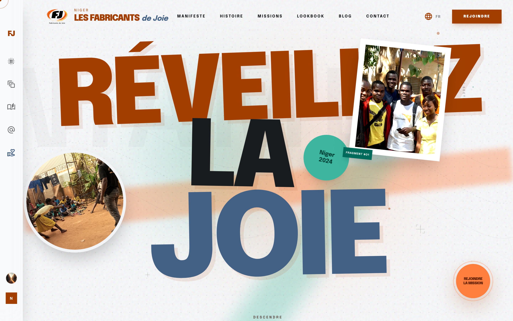

# Site Web Officiel des Fabricants de Joie (FJ Niger)

> **Projet :** `site_web_des_fj_niger`  
> **Production URL :** [https://fj-niger.vercel.app](https://fj-niger.vercel.app)  
> Plateforme web immersive et moderne pour l'ONG **Les Fabricants de Joie du Niger (FJ Niger)** — Propulser la culture, l'autonomie, l'art et l'impact social au Niger depuis 1976.



---

## 🌟 Aperçu & Points Clés

- **Design Immersif & Scrollytelling :** Expérience utilisateur fluide avec animations GSAP & Lenis Smooth Scroll, curseur interactif et mise en scène narrative en 6 actes.
- **Full-Stack Next.js 16 (App Router) & React 19 :** Rendu hybride ultra-rapide avec Server Components et Server Actions.
- **Gestion de Contenu & Blog :** Système de publication complet avec éditeur TipTap riche, catégories dynamiques, tags et support média.
- **Authentification Sécurisée :** Intégration Better-Auth avec gestion des rôles (Admin, Éditeur).
- **Base de Données & ORM :** Prisma ORM avec LibSQL / SQLite optimisé pour le déploiement serverless.
- **Design System Tailor-Made :** Tailwind CSS v4, typographie Epilogue / Inter / Space Grotesk, icônes Material Symbols et conformité Human Interface / Web design guidelines.

---

## 🛠️ Stack Technique

| Domaine | Technologies |
|---|---|
| **Frontend** | Next.js 16 (Turbopack), React 19, Tailwind CSS v4, Framer Motion, GSAP, Lenis |
| **Backend & API** | Next.js API Routes, Better-Auth, LibSQL |
| **Base de Données** | Prisma ORM, SQLite / LibSQL |
| **Édition de Contenu**| TipTap (Rich Text & Image Embeds) |
| **Hébergement & CI/CD** | Vercel & GitHub Actions |

---

## 🚀 Démarrage Rapide

### Prérequis
- Node.js 20+ ou 22+
- npm ou pnpm

### Installation

```bash
# Cloner le dépôt
git clone https://github.com/karaag2/site_web_des_fj_niger.git
cd site_web_des_fj_niger

# Installer les dépendances
npm install

# Générer le client Prisma
npx prisma generate

# Lancer le serveur de développement
npm run dev
```

L'application est accessible sur `http://localhost:3000`.

---

## 📁 Architecture du Projet

```text
├── prisma/               # Schéma Prisma, migrations et base locale SQLite
├── public/               # Assets graphiques, images des missions et logos FJ
├── src/
│   ├── app/              # Next.js App Router (pages d'accueil, blog, admin, auth, contact)
│   ├── components/       # Composants UI (Hero, Manifesto, Lookbook, Stories, Nav, Cursor)
│   ├── lib/              # Connecteurs DB (Prisma/LibSQL), Better-Auth, utilitaires
│   └── services/         # Services métier (posts, categories, contact)
└── next.config.ts        # Configuration Next.js & optimisation des images
```

---

## 🌐 Déploiement

Déployé en continu avec **Vercel** et lié au dépôt GitHub [`karaag2/site_web_des_fj_niger`](https://github.com/karaag2/site_web_des_fj_niger).
